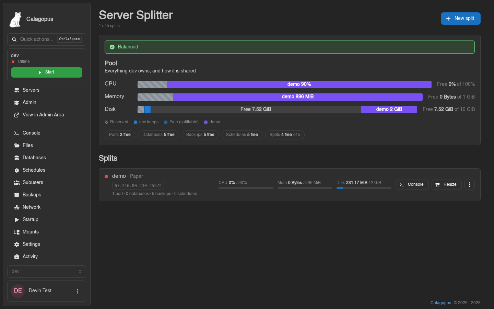
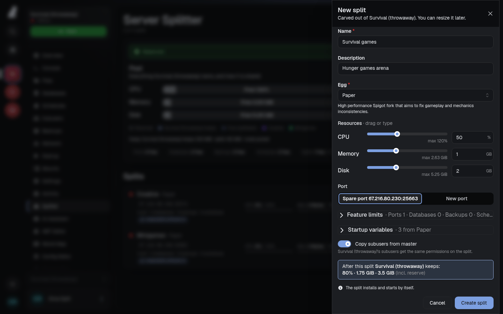
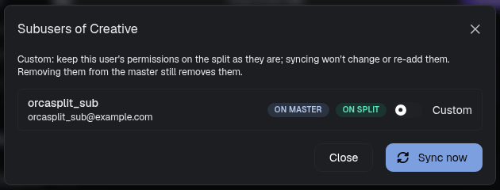
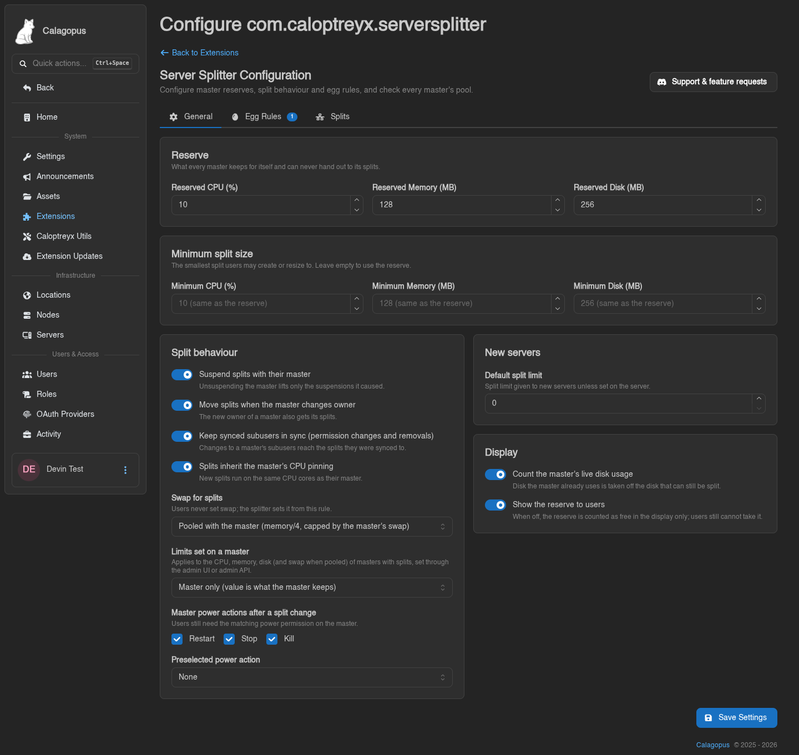
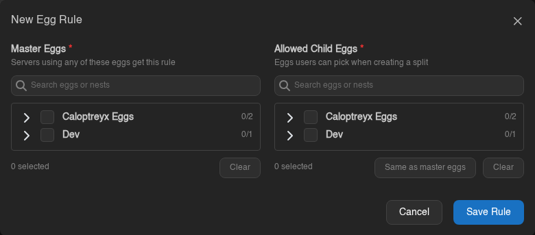
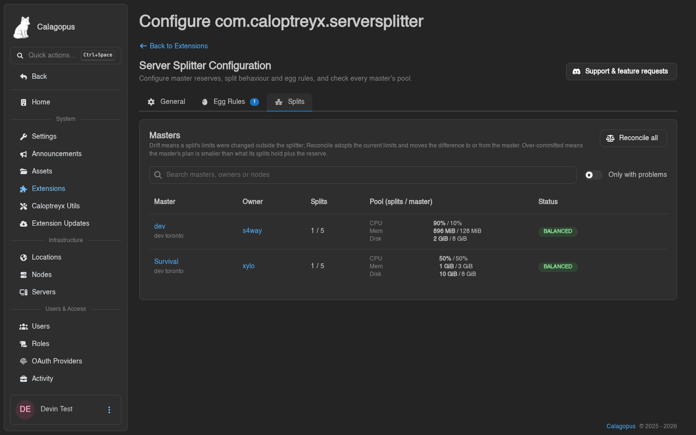
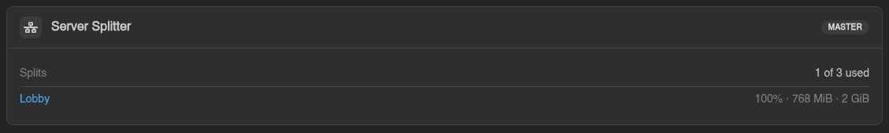
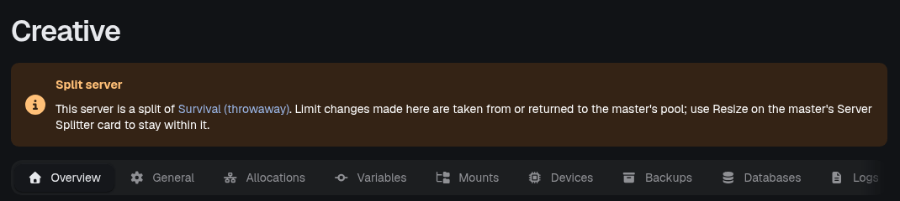

# Server Splitter

A [Calagopus Panel](https://calagopus.com) extension that lets users split a master server's
resources into separate child servers, each with its own console, files, egg and allocation.
Deleting a split gives back exactly what it took.

Package name: `com.caloptreyx.serversplitter` · Requires panel `>=1.2.11`

## What your users get

- A **Splitter** tab on every server. On a master, a pool card shows the master's CPU, memory
  and disk, what each split holds and what is still free.
- Split rows with live status and usage, and actions to **Resize**, **Sync users from master** or
  **Delete split**.
- A **New split** drawer: name, egg and its startup variables, CPU, memory and disk as sliders
  (memory and disk in GB), feature limits, and the port. The split either takes one of the
  master's spare ports or gets a new port on the node. A live summary shows what the master keeps.
- The split starts after install only when the user has the **Start** permission.
- **Resize** within the pool, never below what the split already uses.
- **Delete** by typing the split's name, optionally returning its ports to the master.
- Splits that are suspended, installing, restoring a backup or being transferred can't be resized
  or synced; a split whose install or restore failed can still be deleted.
- Synced subusers: **Sync users from master** adds missing master subusers and updates the
  permissions of synced ones. Removing a subuser from the master, or changing their permissions
  there, reaches the splits automatically. Subusers marked *custom* keep their split permissions
  and are never re-added by sync.
- Copying subusers needs the subuser permissions and never grants more than the acting user holds.
- A split's own Splitter page shows its share of the master and links back to it.

## What you get

- **Reserve**: CPU, memory and disk every master keeps for itself.
- **Minimum split size** for limited resources, and a **default split limit** for new servers.
- **Split behaviour** settings:
  - suspending a master suspends its splits (unsuspending lifts only those);
  - changing a master's owner moves its splits;
  - mirror subuser removals and permission changes from the master;
  - inherit the master's CPU pinning;
  - swap mode: `pooled` (a quarter of the split's memory, taken from the master's swap and capped
    by what it has left), `none` or `copy`.
  The bandwidth cap is copied. Other extensions' per-server limits (subdomains, proxies and the
  like) are `0` on splits. KVM/hugepages passthrough is not copied.
- **Egg rules**: which child eggs may be created from which master eggs. One rule per master egg;
  overlapping rules are rejected.
- A **Splits** tab listing masters with splits and their health: *balanced*, *drift* (limits
  changed outside the splitter) or *untracked*. **Reconcile** adopts a split's current limits and
  moves the difference to or from the master, per master or for all.
- Ledger accounting: every split's share is recorded. Deleting a split returns exactly what it
  took. Admin edits of a split's limits move the difference to or from the master.
- A **Server Splitter** card on the admin server overview with a pool-aware **Resize**, and a
  notice on every admin page of a split.
- Deleting a master deletes its splits first.

## Installation

Download `com_caloptreyx_serversplitter.c7s.zip` from the
[latest release](https://github.com/Caloptreyx/serversplitter/releases/latest) and either upload it
under **Admin → Extensions** or drop it into your heavy image's `build/extensions/` directory and
`docker compose restart web`. Extensions require the `:heavy` panel image - see the
[Calagopus docs](https://calagopus.com/docs/panel/extensions/installing-extensions).

## Upgrading from 1.5.2

The migration records what every existing split holds, taken from its current limits (swap is
counted as not taken). Split subusers whose permissions differ from the master's are kept as
*custom*. New settings start at their defaults: suspend with master, move with owner change,
mirror subusers and inherit CPU pinning on, swap pooled, minimum split size = the reserve. Nothing
changes on running servers.

## Configuration

**Admin → Extensions → Server Splitter → Configure**

1. **General** - reserve, minimum split size, default split limit and split behaviour.
2. **Egg Rules** - add at least one rule. *Master Eggs* are the eggs the rule applies to, *Allowed
   Child Eggs* are the eggs users may pick when splitting such a server.
3. Give servers a splits limit, either through the default for new servers or per server in the
   admin server's **General** tab under **Feature Limits**. Existing servers start at `0`
   (disabled).

Permissions: server `splitter.read|create|update|delete` (syncing subusers also needs
`subusers.create|update`), admin `extensions.splitter.read|write` (admin resize also needs
`servers.update`).

## Screenshots

**New split** - sliders bounded by the pool, egg variables, port choice and what the master keeps.

**Manage subusers** - synced and custom subusers of a split.

**General Settings** - reserve, minimum split size, default limit and split behaviour.

**Egg Rules** - which child eggs may be split off which master eggs.

**Splits** - masters with splits, their health and Reconcile.

**Admin server overview** - a master's splits with Resize, and the notice on a split's admin pages.

## API

Client, under `/api/client/servers/{server}`:

- `GET|POST /splitter`, `GET /splitter/nests`
- `PATCH|DELETE /splitter/{split}` (`DELETE` takes `?return_port`)
- `POST /splitter/{split}/subusers-sync`, `GET /splitter/{split}/subusers`
- `PUT /splitter/{split}/subusers/{user}/custom`

Admin, under `/api/admin/extensions/com.caloptreyx.serversplitter`:

- `GET|PUT /settings`
- `POST /egg-rules`, `PUT|DELETE /egg-rules/{id}`
- `GET /servers/{server}` - a server's master or splits; `PATCH /servers/{split}/resize`
- `GET /splits`, `POST /splits/{master}/reconcile`, `POST /splits/reconcile`

Full schemas are in the panel's OpenAPI document once installed.

## Support

Need help or want to request a feature? Join the [Caloptreyx Discord](https://discord.gg/4qjMWU7S8x).

## License

Released under the MIT License. See [LICENSE](LICENSE).
